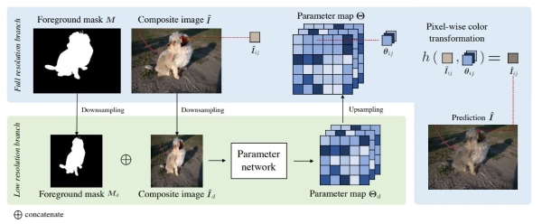

# Image Harmonization

Image harmonization aims to adjust the foreground illumination and color in a composite image so that it is consistent with the background.

`ImageHarmonizationModel` now supports **two backends**:

- **PCTNet**: fast pixel-wise color transformation, suitable for most regular harmonization tasks.
- **LBM**: diffusion-based harmonization backend with controllable inference steps and resolution.

## PCTNet:

> **PCT-Net: Full Resolution Image Harmonization Using Pixel-Wise Color
> Transformations**  [[pdf]](https://openaccess.thecvf.com/content/CVPR2023/papers/Guerreiro_PCT-Net_Full_Resolution_Image_Harmonization_Using_Pixel-Wise_Color_Transformations_CVPR_2023_paper.pdf) [[code]](https://github.com/rakutentech/PCT-Net-Image-Harmonization) 
> 
> Guerreiro, Julian Jorge Andrade and Nakazawa, Mitsuru and Stenger, Bj\"orn 
> Accepted by **CVPR2023**.

**Brief Method Summary**

PCTNet takes in a downsampled image and outputs spatial-aware color transformation parameters, which are interpolated and applied to the foreground region of full-resolution composite image.

## LBM:

> **LBM: Latent Bridge Matching for Fast Image-to-Image Translation** [[pdf]](https://arxiv.org/pdf/2503.07535)  [[code]](https://github.com/gojasper/LBM) 
> 
> Clément Chadebec, Onur Tasar, Sanjeev Sreetharan, Benjamin Aubin  
> Accepted by **ICCV2025**.

**Brief Method Summary**

LBM learns a direct mapping between source and target latent by matching bridge distributions defined along interpolation paths. It performs more stably than other diffusion-based models which learns a mapping between noise and target latent conditioned on source image.
