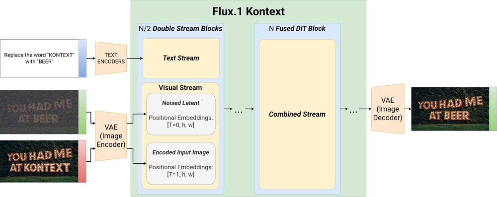

# KontextBlendingHarmonization

Based on FLUX.1 Kontext, we provide the model KontextBlendingHarmonization which supports two functions: image harmonization and image blending. Image harmonization adjusts the foreground illumination in a composite image to be consistent with the background. Image blending seamlessly combines a foreground object with a background so that the composite appears natural and visually coherent.

> **FLUX.1 Kontext: Flow Matching for In-Context Image Generation and Editing in Latent Space**  [[paper]](https://arxiv.org/abs/2506.15742)  
> 
> Black Forest Labs, Stephen Batifol, Andreas Blattmann, Frederic Boesel, Saksham Consul, Cyril Diagne, Tim Dockhorn, Jack English, Zion English, Patrick Esser, Sumith Kulal, Kyle Lacey, Yam Levi, Cheng Li, Dominik Lorenz, Jonas Müller, Dustin Podell, Robin Rombach, Harry Saini, Axel Sauer, Luke Smith 

## Brief Method Summary

FLUX.1 Kontext is a unified image generation and editing framework built on the Flux Transformer. It accepts text prompts together with one reference image. Based on FLUX.1 Kontext, we train LoRA adapters and obtain two models for image blending and image harmonization.