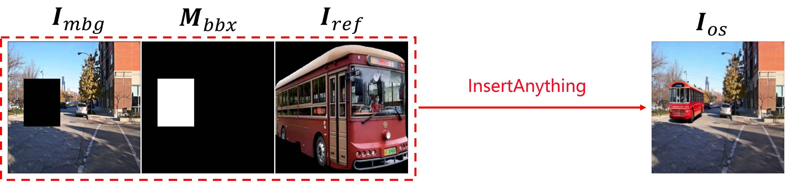

# OS Insert

`OSInsertModel` is an object insertion model that inserts a foreground object into a given bounding box in the background image. It supports two inference modes:

- **conservative**: weak ability to adjust pose and viewpoint 
- **aggressive**: strong ability to adjust pose and viewpoint

The implementation is based on the following two papers. 

ObjectStitch:

> **ObjectStitch: Object Compositing With Diffusion Model** [[pdf]](https://openaccess.thecvf.com/content/CVPR2023/papers/Song_ObjectStitch_Object_Compositing_With_Diffusion_Model_CVPR_2023_paper.pdf) [[code]](https://github.com/bcmi/ObjectStitch-Image-Composition)  
> 
> Song, Yizhi and Zhang, Zhifei and Lin, Zhe and Cohen, Scott and Price, Brian and Zhang, Jianming and Kim, Soo Ye and Aliaga, Daniel  
> 
> Accepted by **CVPR 2023**.

InsertAnything:

> **Insert Anything: Image Insertion via In-Context Editing in DiT** [[pdf]](https://arxiv.org/abs/2504.15009) [[code]](https://github.com/song-wensong/insert-anything)  
> 
> Song, Wensong and Jiang, Hong and Yang, Zongxing and Quan, Ruijie and Yang, Yi  
> 
> Accepted by **AAAI 2026**.

ObjectStitch is good at adjusting foreground pose/view to be compatible with background, but cannot preserve the foreground details accurately. On the contrary, InsertAnything can fit the specified foreground mask and preserve the foreground details accurately, but cannot achieve large-scale pose/view adjustment given a bounding box mask. 

In "conservative" mode, we feed background image, bounding box mask, and foreground reference into **InsertAnything**.

In "aggressive" mode,  we adopt a two-stage approach named [OSInsert](https://arxiv.org/pdf/2602.19523). In the first stage, we use **ObjectStitch** to generate an intermediate composite image with a foreground object that has a plausible pose, viewpoint, and geometric alignment with the background. We then use the Segment Anything Model (SAM) to extract a high-precision foreground mask from this intermediate result. In the second stage, we utilize **InsertAnything**  to fill the foreground region defined by the SAM-extracted mask with the foreground reference.

