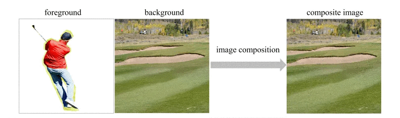

# OVERVIEW

**_libcom_ (the library of image composition) is an image composition toolbox.** The goal of [image composition](https://github.com/bcmi/Awesome-Image-Composition) ([object insertion](https://github.com/bcmi/Awesome-Object-Insertion)) is inserting one foreground into a background image to get a realistic composite image, by addressing the inconsistencies (appearance, geometry, and semantic inconsistency) between foreground and background. Generally speaking, image composition could be used to combine the visual elements from different images.

**_libcom_ covers a diversity of related tasks in the field of image composition**, including image blending, standard/painterly image harmonization, shadow generation, reflection generation, object placement, generative composition, quality evaluation, *etc*. For each task, we integrate one or two selected methods considering both efficiency and effectiveness. The selected methods will be continuously updated upon the emergence of better methods.

**The ultimate goal of this library is solving all the problems related to image composition with simple `import libcom`.** 
Welcome to follow WeChat public account ["Newly AIGCer"](https://www.ustcnewly.com/blog.html) or Zhihu Column ["Newly CVer"](https://www.zhihu.com/column/c_1333918224900206592) to get the latest information about image composition!

**Welcome to recommend your self-developed models or models you have tested by opening an issue. If a model delivers outstanding and stable performance, we will consider integrating it into libcom.**

**If you specialize in model inference acceleration, we welcome both voluntary and paid collaborations. Please contact us at ustcnewly@sjtu.edu.cn.**

## Main Functions

- **get_composite_image** generates composite images using naive copy-and-paste followed by image blending (alpha blending or Poisson blending).

- **color_transfer** adjusts the foreground color to match the background using traditional color transfer method.

- **ImageHarmonizationModel** [[PCTNet]](https://github.com/rakutentech/PCT-Net-Image-Harmonization) [[LBM]](https://github.com/gojasper/LBM) adjusts the foreground illumination to be compatible the background given photorealistic background and photorealistic foreground.

- **PainterlyHarmonizationModel** [[PHDNet]](https://github.com/bcmi/PHDNet-Painterly-Image-Harmonization) [[PHDiffusion]](https://github.com/bcmi/PHDiffusion-Painterly-Image-Harmonization) adjusts the foreground style to be compatible with the background given artistic background and photorealistic foreground.

- **InharmoniousLocalizationModel** [[MadisNet]](https://github.com/bcmi/MadisNet-Inharmonious-Region-Localization) localizes the inharmonious region in a synthetic image.

- **HarmonyScoreModel** [[BargainNet]](https://github.com/bcmi/BargainNet-Image-Harmonization) evaluates the harmony level between foreground and background in a composite image, that is, whether the illumination of foreground is harmonious with that of background.

- **FOSScoreModel** [[DiscoFOS]](https://github.com/bcmi/Foreground-Object-Search-Dataset-FOSD) evaluates the compatibility between foreground and background in a composite image in terms of geometry and semantics, that is, whether the geometric perspective of foreground matches that of background, and whether the semantic context of foreground in the background is reasonable.

- **OPAScoreModel** [[OPA]](https://github.com/bcmi/Object-Placement-Assessment-Dataset-OPA) evaluates the rationality of foreground object placement (location, scale) in a composite image.

- **FOPAHeatMapModel** [[FOPA]](https://github.com/bcmi/FOPA-Fast-Object-Placement-Assessment) can predict the rationality scores for all locations/scales given a background-foreground pair, when placing the foreground with certain scale at certain location in the background. Based on the predicted rationality score map, the model can output the composite image with optimal location/scale.

- **QwenScoreModel** [[Qwen3-VL]](https://github.com/QwenLM/Qwen3-VL) can predict the harmony score, FOS score, OPA score given a composite image and a composite mask.The prediction score is within [0,1].

- **ShadowGenerationModel** [[GPSDiffusion]](https://github.com/bcmi/GPSDiffusion-Object-Shadow-Generation) generates plausible shadow for the inserted object in a composite image.

- **ReflectionGenerationModel** [[RGDiffusion]](https://github.com/bcmi/Object-Reflection-Generation-Dataset-DEROBA) generates plausible reflection for the inserted object in a composite image.

- **KontextBlendingHarmonizationModel** [[FluxKontext]](https://github.com/black-forest-labs/flux) is a generative image composition model which inserts foreground into the specified bounding box in the background. The pose and view of foreground stay unchanged. The "blending" mode does not adjust the foreground illumination, while the "harmonization" mode adjusts the foreground illumination to make the composite image harmonious.

- **OSInsertModel** [[ObjectStitch]](https://github.com/bcmi/ObjectStitch-Image-Composition) [[OSInsert]](https://github.com/bcmi/OSInsert-Image-Composition) is a generative image composition model which inserts foreground into the specified bounding box in the background. The "conservative" mode has weak ability to adjust the pose and view of foreground according to the background. The "aggressive" mode has stronger ability to adjust the pose and view of foreground according to the background. You can also use foreground shape mask for controllable composition.

- **QwenEditModel** [[Qwen-Image-2.1]](https://github.com/QwenLM/Qwen-Image-2.1) is a generative image composition model which inserts foreground into the specified bounding box in the background. The pose and view of foreground stay unchanged. The model can generate shadow and reflection for the foreground. The "artistic" mode applies to artistic background images, while the "photorealistic" mode applies to photorealistic background images.

**For the detailed method descriptions, code examples, visualization results, and performance comments, please refer to our [[documents]](https://libcom.readthedocs.io/en/latest/).** If the model performance is not satisfactory, you can finetune the pretrained model on your own dataset using the source repository and replace the original model.

## How to Use this Guide

Here is a detailed step-by-step guide to learn more about libcom:

1. For installation instructions, please see [get_started](https://libcom.readthedocs.io/en/latest/get_started.html).

2. Learn the usage of libcom by refering to [API Reference](https://libcom.readthedocs.io/en/latest/api.html).
