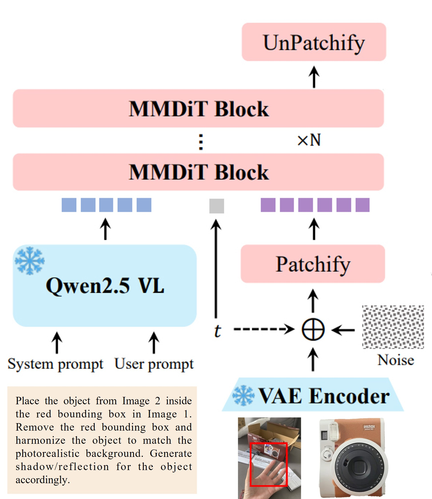

# Qwen-VL  Score Prediction

We use Qwen-Image-2.1 to insert foreground into the specified bounding box in the background. The model supports both artistic background images and photorealistic background images. For artistic background images, the model adjusts the artistic style of foreground to be compatible with background. For photorealistic background images, the model adjusts the illumination of foreground to be compatible with background. For both types,  the model can generate shadow and reflection for the inserted foreground. 

The pose and view of foreground stay unchanged. We have tried adjusting the pose and view of foreground according to the background, but the performance is not very stable. Therefore, for pose and view of foreground, we recommend using OSInsertModel. 

> **Qwen-Image-2.1 Technical Report** [[blog]](https://qwen.ai/blog?id=qwen-image-2.1) [[code]](https://github.com/QwenLM/Qwen-Image-2.1)
> 
> Qwen Team

## Brief Method Summary

Qwen-Image-2.1 takes in a background image with red bounding box and a reference foreground, producing a composite image. We add task-specific LoRA adapters and prompts for artistic background images and photorealistic background images.
