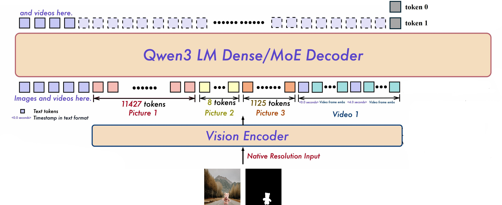

# Qwen-VL  Score Prediction

We use Qwen3-VL to evaluate a composite image from different aspects. 

- OPA score: the rationality of foreground object placement (location, scale) in a composite image.
- FOS score: the compatibility between foreground and background in a composite image in terms of geometry and semantics, that is, whether the geometric perspective of foreground matches that of background, and whether the semantic context of foreground in the background is reasonable.
- Harmony score: the harmony level between foreground and background in a composite image, that is, whether the illumination of foreground is harmonious with that of background.

> **Qwen3-VL Technical Report** [[arXiv]](https://arxiv.org/pdf/2511.21631.pdf) [[code]](https://github.com/QwenLM/Qwen3-VL)
> 
> Shuai Bai, Yuxuan Cai, Ruizhe Chen, Keqin Chen, Xionghui Chen, Zesen Cheng, Lianghao Deng, Wei Ding, Chang Gao, Chunjiang Ge, Wenbin Ge, Zhifang Guo, Qidong Huang, Jie Huang, Fei Huang, Binyuan Hui, Shutong Jiang, Zhaohai Li, Mingsheng Li, Mei Li, Kaixin Li, Zicheng Lin, Junyang Lin, Xuejing Liu, Jiawei Liu, Chenglong Liu, Yang Liu, Dayiheng Liu, Shixuan Liu, Dunjie Lu, Ruilin Luo, Chenxu Lv, Rui Men, Lingchen Meng, Xuancheng Ren, Xingzhang Ren, Sibo Song, Yuchong Sun, Jun Tang, Jianhong Tu, Jianqiang Wan, Peng Wang, Pengfei Wang, Qiuyue Wang, Yuxuan Wang, Tianbao Xie, Yiheng Xu, Haiyang Xu, Jin Xu, Zhibo Yang, Mingkun Yang, Jianxin Yang, An Yang, Bowen Yu, Fei Zhang, Hang Zhang, Xi Zhang, Bo Zheng, Humen Zhong, Jingren Zhou, Fan Zhou, Jing Zhou, Yuanzhi Zhu, Ke Zhu

## Brief Method Summary

Qwen3-VL takes a composite image, a composite mask, and a prompt as input. We add task-specific LoRA adapters and prompts for OPA score, FOS score, and harmony score. Instead of generating a text response, the modified version reads the next-token logits at the final prompt position, keeps only the logits for the tokenizer’s “0” and “1” tokens, and applies softmax to that pair to produce a continous score within [0,1].

Test-time augmentation (TTA) is disabled by default, so each score uses one forward pass. Pass `enable_tta=True` to `QwenScoreModel` to enable the three-view TTA used for the reported benchmarks: OPA and FOS average the original, horizontally flipped, and 1.1x zoomed views; Harmony takes the median of the original, 1.1x, and 1.2x zoomed views.
